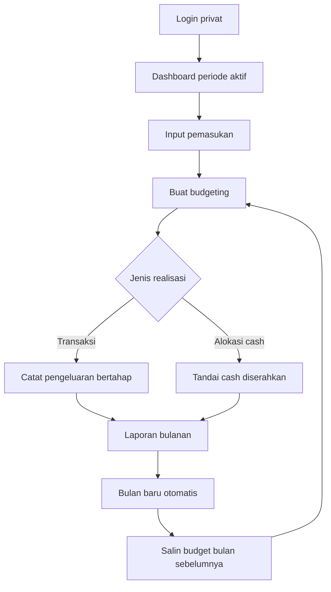

# Rancangan MVP Budgeting Plan

## 1. Prinsip produk

Budget adalah pusat model. Pemasukan menentukan dana yang tersedia, setiap pengeluaran wajib merealisasikan sebuah budget, dan laporan membaca hasil perencanaan versus realisasi. Tidak ada jalur “pengeluaran bebas”.

## 2. User flow



Alur dua perangkat: User A menulis dokumen ke household, listener Firestore User B menerima snapshot baru, context memperbarui state, lalu layar terkait dirender ulang.

## 3. Struktur layar dan navigasi

```text
RootStack
├── Login                     (ketika belum terautentikasi)
└── AuthenticatedStack
    ├── MainTabs
    │   ├── Home / Dashboard
    │   ├── Pemasukan
    │   ├── Budgeting
    │   ├── Pengeluaran
    │   └── Laporan
    └── Settings / Data Master
```

`AuthProvider` mengontrol pergantian Login/AuthenticatedStack. `BudgetProvider` aktif setelah profil dan household tersedia; provider memasang listener realtime untuk periode, master, pemasukan, budget, dan pengeluaran.

## 4. Wireframe halaman

### Login

```text
┌─────────────────────────────┐
│          [ Logo ]           │
│       Budgeting Plan        │
│  Rencanakan sebelum belanja │
│ ┌─────────────────────────┐ │
│ │ Selamat datang          │ │
│ │ Username [............] │ │
│ │ Password [............] │ │
│ │ [       Masuk         ] │ │
│ └─────────────────────────┘ │
└─────────────────────────────┘
```

### Dashboard

```text
┌ Budgeting Plan          ⚙ ┐
│ [ Agustus 2026 ▼ ]        │
│ ┌────────────────────────┐│
│ │ Sisa budget Rp2.200.000││
│ │ ███████░░ 72%          ││
│ └────────────────────────┘│
│ [Pemasukan] [Budget]      │
│ [Realisasi] [Blm alokasi] │
│ Ringkasan sumber dana     │
│ ┌ Debit ───── sisa ... ┐  │
│ └──────────────────────┘  │
│ Home In  Budget Out Report│
└───────────────────────────┘
```

### Pemasukan

```text
┌ Pemasukan                  ┐
│ [ Agustus 2026 ▼ ]         │
│ Total pemasukan Rp7.000.000│
│ Gaji              Rp700.000│
│ TPP             Rp6.300.000│
│                       [+]  │
└────────────────────────────┘
Modal +: Kategori, Nominal, Tanggal, Catatan
```

### Budgeting

```text
┌ Budgeting                  ┐
│ Total rencana Rp6.500.000  │
│ TAGIHAN RUTIN     Rp518.500│
│ █████░░                     │
│ ┌ Listrik        [Belum] ┐ │
│ │ Kartu Kredit • Transaksi│ │
│ │ Rp253.000   Sisa 253.000│ │
│ └────────────────────────┘ │
│ ┌ Uang Belanja [Cash]    ┐ │
│ │ [Tandai sudah diserahkan]│
│ └────────────────────────┘ │
│                       [+]  │
└────────────────────────────┘
Modal +: Nama, Kategori, Nominal, Sumber, Jenis, Catatan
```

### Pengeluaran

```text
┌ Pengeluaran                ┐
│ Total realisasi Rp3.200.000│
│ Rice Cooker      -Rp150.000│
│ Elektronik • Kartu Kredit  │
│ Listrik          -Rp253.000│
│                       [+]  │
└────────────────────────────┘
Modal +: Pilih Budget → tampil detail & sisa → Nominal, Tanggal, Catatan
```

### Laporan

```text
┌ Laporan                    ┐
│ [ Agustus 2026 ▼ ]         │
│ [Income] [Budget] [Real]   │
│ [Per kategori|Per sumber]  │
│ Tagihan: B 1,5jt / R 1,45jt│
│ Detail budgeting           │
│ Nama • kategori • sumber   │
│ Budget | Realisasi | Sisa  │
│ Belum terealisasi          │
│ Mouse               Rp200rb│
└────────────────────────────┘
```

### Pengaturan / Data Master

```text
┌ ← Pengaturan & Data Master ┐
│ [Profil + peran household] │
│ [Pemasukan|Budget|Sumber]  │
│ Gaji                    ✎  │
│ TPP                     ✎  │
│ + Tambah kategori          │
│ [ Keluar dari akun ]       │
└────────────────────────────┘
```

## 5. Struktur Cloud Firestore

```text
users/{uid}
households/{householdId}
  members/{uid}
  incomeCategories/{categoryId}
  budgetCategories/{categoryId}
  fundSources/{sourceId}
  periods/{YYYY-MM}
    incomes/{incomeId}
    budgets/{budgetId}
    expenses/{expenseId}
    creditLimits/{fundSourceId}
```

Relasi:

- `users.householdId → households.id`
- `periods.householdId → households.id`
- `income.categoryId → incomeCategories.id`
- `budget.categoryId → budgetCategories.id`
- `budget.fundSourceId → fundSources.id`
- `expense.budgetId → budgets.id` (wajib)
- `creditLimits.fundSourceId → fundSources.id` (limit kartu kredit per periode)
- Setiap transaksi periode membawa `householdId`, `periodId`, `createdBy`, `createdAt`, `updatedBy`, dan `updatedAt`.

Master menggunakan referensi ID dan snapshot nama. Snapshot menjaga arsip tetap terbaca setelah master diubah/dihapus.

## 6. Model TypeScript

Interface lengkap berada di `src/models/index.ts`: `UserProfile`, `Household`, `HouseholdMember`, `Period`, `IncomeCategory`, `BudgetCategory`, `FundSource`, `Income`, `Budget`, `Expense`, `PeriodData`, dan tipe summary.

Nominal disimpan sebagai integer Rupiah, bukan floating point mata uang. Tanggal transaksi disimpan `YYYY-MM-DD`; timestamp audit menggunakan server timestamp Firestore.

## 7. Business logic

```text
Saldo Debit = Σ income.amount
Total Budget = Σ budget.amount
Total Realisasi = Σ budget.realizedAmount
Sisa Item = max(0, budget.amount - budget.realizedAmount)
Sisa Kelompok = Σ budget - Σ realized
Debit Belum Dialokasikan = Saldo Debit - Σ budget bersumber Debit
Sisa Limit Kredit = Σ creditLimits.amount - Σ budget bersumber Kartu Kredit
Progress = min(100%, Total Realisasi / Total Budget)
```

Limit kartu kredit dicatat ulang pada setiap periode dan tidak diperlakukan sebagai saldo.
Nilai `fundSources.monthlyLimit` hanya menjadi saran/default saat pengguna mengisi limit
aktual bulan berjalan.

Status:

- `unrealized`: realisasi 0.
- `partial`: 0 < realisasi < budget.
- `realized`: realisasi = budget.
- `cash_allocated`: alokasi cash sudah ditandai diserahkan.

Realisasi transaksi dilakukan dalam satu Firestore transaction:

1. Baca budget terbaru dari server/cache transaksi.
2. Hitung `remaining = amount - realizedAmount`.
3. Tolak bila input lebih besar; pesan menampilkan selisih Rupiah.
4. Buat expense yang membawa `budgetId`.
5. Tambah `budget.realizedAmount` dalam commit atomik yang sama.

Jika perangkat A dan B melakukan commit bersamaan, Firestore mengulang transaksi yang kalah dengan data terbaru. Validasi kemudian berjalan kembali sehingga total tidak melampaui budget.

Alokasi cash tidak membuat expense. Tombol serahkan mengubah `cashAllocated = true` dan `realizedAmount = amount` secara atomik.

## 8. Sistem periode

- ID periode deterministik: `YYYY-MM`.
- Login pertama pada bulan baru membuat periode current bila belum ada.
- Periode lama diubah menjadi `archived`, tidak dihapus.
- Master tetap berada di level household.
- Semua tab menggunakan period picker yang sama.
- Salin bulan sebelumnya hanya boleh ketika periode tujuan belum memiliki budget; semua realisasi di-reset ke nol.

## 9. Struktur folder

```text
src/
├── components/       # design system, form modal, header, finance UI
├── constants/        # warna, spacing, typography
├── domain/           # fungsi bisnis murni + unit test
├── models/           # interface Firestore/TypeScript
├── navigation/       # root stack dan bottom tabs
├── screens/          # Login, Dashboard, Pemasukan, Budgeting, Pengeluaran, Laporan, Settings
├── services/         # Firebase auth, Firestore listener, repository/transaction
├── state/            # AuthContext dan BudgetContext
└── utils/            # Rupiah, periode, tanggal
```

## 10. UI/UX

- Hijau gelap digunakan sebagai warna perencanaan/keuangan; warning amber dan danger merah hanya untuk status.
- Kartu ringkasan memakai angka besar, sedangkan detail memakai list ringkas agar mudah dipindai satu tangan.
- FAB hanya ada pada tiga aktivitas input utama.
- Form panjang ditempatkan pada full-screen modal agar keyboard Android tidak menutupi konteks.
- Aksi edit: ketuk item. Aksi destruktif: tahan item lalu konfirmasi.
- Semua nilai menggunakan locale `id-ID` dan format `Rp6.300.000`.

## 11. Tahapan implementasi hingga APK

1. Fondasi: model domain, format Rupiah, periode, navigation, design system.
2. Firebase: Android app config, Auth, profil user, household member, Firestore rules.
3. Realtime state: listener master/periode/data dan audit fields.
4. Alur planning: Pemasukan → Budgeting → transaksi/alokasi cash.
5. Laporan: summary kategori, sumber dana, detail, dan unrealized.
6. Hardening: unit test kalkulasi, emulator/rules test, uji konkurensi dua perangkat.
7. Android QA: layar kecil, keyboard, offline/reconnect, rotasi, dan locale Indonesia.
8. Release: keystore produksi, versioning, `assembleRelease`, smoke test APK fisik.

## 12. Setelah MVP stabil

Grafik tahunan, export Excel/PDF, notifikasi, backup manual, dan dark mode sengaja tidak masuk jalur kritis MVP. Tambahkan setelah sinkronisasi dua perangkat, transaksi konkurensi, dan laporan bulanan terbukti stabil.
